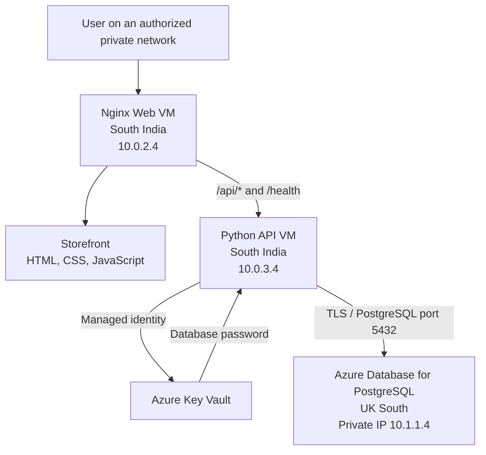

# HA Retail – Azure Three-Tier Retail Application

A cloud engineering portfolio project demonstrating a private three-tier retail application on Microsoft Azure.

The project includes a web tier, Python API tier, Azure Database for PostgreSQL, managed identity, Azure Key Vault, private networking, and Terraform infrastructure definitions.

**Project status:** The initial application implementation has been deployed and tested across the private Azure network. High availability (HA) is not yet implemented or demonstrated. The Nginx-hosted website is not currently exposed to the public internet.

## 1. Architecture



### Request flow

1. Nginx on the web VM serves the storefront.
2. The storefront requests product data from `/api/products`.
3. Nginx forwards API requests to the Python API on the app VM.
4. The API uses the app VM's system-assigned managed identity to retrieve the database password from Key Vault.
5. The API connects to PostgreSQL using SSL.
6. PostgreSQL returns product records to the API.
7. The API returns JSON, which the storefront displays.

The `/health` endpoint checks database connectivity as well as API availability.

## 2. Azure infrastructure

| Component | Configuration |
|---|---|
| Main resource group | `ha-retail-southindia` |
| Web VM | `ha-retail-southindia-web-vm` |
| Web VM private IP | `10.0.2.4` |
| App VM | `ha-retail-southindia-app-vm` |
| App VM private IP | `10.0.3.4` |
| Main virtual network | `ha-retail-vnet` |
| Main VNet address space | `10.0.0.0/16` |
| Web subnet | `10.0.2.0/24` |
| App subnet | `10.0.3.0/24` |
| PostgreSQL server | `ha-retail-southindia-pg` |
| PostgreSQL region | UK South |
| PostgreSQL version | 18 |
| PostgreSQL private IP | `10.1.1.4` |
| Database | `retaildb` |
| Database login | `retailapp` |

The PostgreSQL server uses a separate virtual network:

- VNet: `ha-retail-southindia-postgresql-vnet`
- Address space: `10.1.0.0/16`
- Delegated subnet: `10.1.1.0/24`

The South India and UK South virtual networks are connected through VNet peering. Private DNS is configured for database name resolution.

PostgreSQL public access is disabled. The server uses a delegated subnet; it does not use a Private Endpoint.

## 3. Application components

### Storefront

Source file: `website/index.html`

The storefront is a responsive product page that:

- Displays product cards and prices.
- Retrieves product data from `/api/products`.
- Shows loading and error states.
- Formats prices as GBP currency.

There are two deployment paths:

**Private VM deployment**

The tested storefront is served by Nginx from `/var/www/html/index.html` on the web VM.

Nginx forwards:
- `/api/` to `http://10.0.3.4:8080`
- `/health` to the API health endpoint.

**Azure Static Web Apps workflow**

The repository contains `.github/workflows/azure-static-web-apps-lemon-desert-0c15a500f.yml`.

This workflow is configured to deploy the `website/` directory to Azure Static Web Apps on pushes to `main`, provided the required GitHub secret is configured.

This is a separate deployment path from the tested private VM deployment. The presence of the workflow alone does not prove that a successful Static Web Apps deployment is currently active.

### Python API

Source files:

- `backend/app.py`
- `backend/requirements.txt`

The API uses:

| Package | Purpose |
|---|---|
| `azure-identity` | Authenticate using Azure managed identity |
| `azure-keyvault-secrets` | Retrieve the database password from Key Vault |
| `psycopg` | Connect to PostgreSQL |

The API runs as a Linux systemd service:

`ha-retail-api.service`

It listens on port `8080`.

#### API endpoints

| Endpoint | Purpose |
|---|---|
| `GET /health` | Checks whether PostgreSQL is reachable |
| `GET /api/products` | Reads products from PostgreSQL and returns JSON |

The API creates the `app.products` table if it does not exist. It inserts three initial sample products using `ON CONFLICT DO NOTHING`.

The sample products are stored in PostgreSQL, not hardcoded into the API response.

### Database

- Server: `ha-retail-southindia-pg`
- Database: `retaildb`
- Schema: `app`
- Table: `products`
- Application login: `retailapp`

The API uses SSL (`sslmode=require`) for its PostgreSQL connection.

### Secrets management

The app VM uses a system-assigned managed identity to access Azure Key Vault.

The identity has the `Key Vault Secrets User` role at the vault scope.

The database password is retrieved from the secret named `retailapp-db-password`.

The server-side environment file contains configuration values. The database password is not stored in that file or in the application source code.

### Network security

- Both VMs have no public IP address.
- PostgreSQL public access is disabled.
- Key Vault uses a firewall with default public network action set to deny.
- The app subnet is permitted through a Key Vault service endpoint and VNet rule.
- The app VM permits inbound TCP port `8080` from the web subnet.
- SSH access uses keys.
- The database connection uses SSL.

The Key Vault configuration uses a service endpoint and VNet rule, not a Private Endpoint.

## 4. Validation performed

The following checks succeeded during deployment:

| Test | Result |
|---|---|
| API health endpoint directly on app VM | HTTP 200 |
| Database connection reported by health endpoint | Connected |
| Storefront homepage through Nginx | HTTP 200 |
| Health endpoint through Nginx | HTTP 200 |
| Products API through Nginx | HTTP 200 |
| Product data source | PostgreSQL |
| Sample products returned | 3 |
| Production API systemd service | Active and enabled |
| Test API service on port 8081 | Stopped and disabled |
| Nginx configuration test | Passed |
| PostgreSQL private connectivity | Tested successfully |

Example product API response:

```json
{
  "source": "postgresql",
  "demo_data": true,
  "products": [
    {
      "id": 1,
      "name": "Everyday Backpack",
      "price": 29.99
    },
    {
      "id": 2,
      "name": "Wireless Headphones",
      "price": 49.99
    },
    {
      "id": 3,
      "name": "Insulated Water Bottle",
      "price": 14.99
    }
  ]
}
```

`demo_data: true` indicates that the returned records are sample data stored in PostgreSQL.

These tests demonstrate the application flow inside the configured private network. They do not prove public internet access or automatic failover.

## 5. Repository structure

```text
.
├── .github/
│   └── workflows/
├── backend/
│   ├── app.py
│   └── requirements.txt
├── docs/
│   └── architecture-decisions.md
├── terraform/
├── terraform-southindia/
├── website/
│   └── index.html
├── .gitignore
└── README.md
```

There are Terraform configurations in two directories. Review the intended directory, variables, and state before running Terraform. Do not assume both directories represent the same deployment or share the same state.

## 6. Running the Python dependencies locally

From the repository root:

```powershell
python -m pip install -r .\backend\requirements.txt
```

The API also requires Azure authentication, the expected environment variables, access to Key Vault, and network access to PostgreSQL.

Do not put real credentials in source files or commit local environment files.

## 7. Known limitations

This project currently demonstrates a working private three-tier application. It is not yet a production high-availability deployment.

The following capabilities are not implemented or have not been demonstrated:

- Multiple independent API instances.
- Application Gateway or another load-balancing layer.
- Automatic health-based failover.
- Redundant application infrastructure.
- A tested database backup and restore procedure.
- Disaster recovery testing.
- Complete monitoring and alerting.
- Public internet access to the Nginx-hosted VM storefront.

The project name includes HA, but high availability must not be considered achieved until redundancy and failover are implemented and tested.

## 8. Possible future improvements

1. Deploy multiple API instances.
2. Add a load balancer and health probes.
3. Implement and test database backup and restore.
4. Add monitoring, logging, and alerts.
5. Test application and database failure scenarios.
6. Document recovery objectives and disaster recovery procedures.
7. Review public ingress requirements and associated Azure costs.

## 9. Cost awareness

Azure virtual machines, PostgreSQL, disks, and networking resources can incur charges.

Deallocating a VM can reduce compute charges, but disks and other resources may continue to incur costs. Review Azure billing and resource status before leaving the environment running.